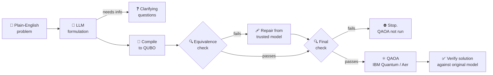

<div align="center">

# ⚛️ VeriQAOA

### Verified QUBO optimization on real IBM Quantum hardware

**Describe an optimization problem in plain English. Get back a quantum-computed answer you can trust.**

[](https://www.python.org/)
[](https://fastapi.tiangolo.com/)
[](https://www.ibm.com/quantum/qiskit)
[](https://quantum.cloud.ibm.com/)
[](https://react.dev/)
[](https://vite.dev/)

[How it works](#-how-it-works) •
[Quick start](#-quick-start) •
[Configuration](#%EF%B8%8F-configuration) •
[API](#-api-reference) •
[Evaluation](#-evaluation)

</div>

---

## ✨ Why VeriQAOA?

Quantum optimizers such as **QAOA** take a problem written as a **QUBO** (Quadratic Unconstrained Binary Optimization). Turning a real problem into a QUBO is easy to get wrong, though. A missing penalty term, a sign error or a penalty that is too small all give you a QUBO whose best answer is **not** the answer to your problem. The quantum computer then solves the wrong problem without any warning.

VeriQAOA puts a **verification layer around every step**:

| | |
|---|---|
| 🧠 **AI formulation** | An LLM turns your plain-English description into a structured binary model. If something essential is missing, it asks you instead of guessing. |
| 🔧 **Exact compilation** | Equality and inequality constraints (`==`, `<=`, `>=`, `<`, `>`) become squared penalties. Binary slack variables are added automatically, and the penalty weight is chosen so that no infeasible answer can beat a feasible one. |
| 🔍 **Equivalence proof** | The compiled QUBO is checked against an independently rebuilt energy function on **every** binary assignment. |
| 🩹 **Automatic repair** | If the check fails, the QUBO is rebuilt from the trusted model and verified again. QAOA **never** runs on an unverified QUBO. |
| ⚛️ **Real quantum hardware** | The optimized QAOA circuit runs on IBM Quantum (on the least busy device by default), or on a local Aer simulator. |
| ✅ **Solution verification** | The quantum result is checked against the original model: constraints, objective value, and how it compares with the exact classical optimum. |

---

## 🧭 How it works



<details>
<summary><b>The five stages in detail</b></summary>

1. **Compile.** Each constraint is first normalized to an exact integer `==` or `<=` form, so every violation is a nonzero integer. Constraints become penalty terms `penalty × violation²`, and inequalities get binary slack variables whose subset sums cover exactly the allowed range. By default the penalty is `floor(Σ|objective coefficients|) + 1`, the smallest integer that keeps every infeasible assignment above the feasible optimum.
2. **Verify the QUBO.** The objective-plus-penalty energy is rebuilt independently of the compiler. For every assignment `x` of the decision variables, the check requires `min over slack s of QUBO(x, s) == expected_energy(x)`. Passing this means the QUBO's minimum, read on the decision variables, is the true penalized optimum.
3. **Repair (only if needed).** The QUBO is rebuilt directly from the model and verified again. If it still fails, the pipeline stops and reports the counterexamples.
4. **Run QAOA.** The QUBO is converted to an Ising Hamiltonian, and the QAOA angles are optimized classically with SciPy on an exact statevector. On hardware, only the **final optimized circuit** is sent to IBM Quantum as one Sampler job. This keeps each solve to a single QPU job, which matters on the Open plan's monthly allowance.
5. **Verify the solution.** The best sample is checked for feasibility, its objective value is computed, and it is compared with a brute-force classical optimum.

</details>

Hardware jobs are **asynchronous**. Submitting returns a job ID right away, and the frontend polls until the counts arrive. Job records are saved to `ibm_jobs/`, so a queued job can still be finished after a server restart.

---

## 🚀 Quick start

### Prerequisites

- **Python 3.11**
- **Node.js 20+**
- An **OpenAI-compatible LLM API key** (OpenAI, Groq or similar)
- *(Optional)* An **IBM Quantum API key** from [quantum.cloud.ibm.com](https://quantum.cloud.ibm.com/). Without one, everything runs on the local simulator.

### 1. Clone and set up the backend

```bash
git clone https://github.com/Arunav1/QUBO_Solver_on_real_IBM_Quantum_Platform.git
cd QUBO_Solver_on_real_IBM_Quantum_Platform

python3.11 -m venv .venv
source .venv/bin/activate
pip install -r backend/requirements.txt
```

### 2. Add your keys

```bash
cp .env.example .env
# then fill in the values (see Configuration below)
```

### 3. Start the API

Run this from the **project root**, because `backend` is imported as a package:

```bash
uvicorn backend.main:app --reload --port 8000
```

Check it at <http://127.0.0.1:8000/health>. Interactive API docs are at <http://127.0.0.1:8000/docs>.

### 4. Start the frontend

```bash
cd frontend
npm install
npm run dev
```

Open the URL Vite prints (usually <http://localhost:5173>). The dev server forwards `/api` and `/health` to the backend on port 8000.

---

## ⚙️ Configuration

All settings are read from `.env` in the project root.

| Variable | Required | Description |
|---|:---:|---|
| `OPENAI_API_KEY` | ✅ | API key for the LLM that formulates problems. |
| `OPENAI_BASE_URL` | | Set this to use any OpenAI-compatible provider, e.g. `https://api.groq.com/openai/v1` for Groq. |
| `OPENAI_MODEL` | | Model name. Defaults to `gpt-4o-mini`. |
| `IBM_QUANTUM_API_KEY` | | IBM Quantum API key. When set, runs go to real hardware by default. |
| `IBM_QUANTUM_CHANNEL` | | Defaults to `ibm_quantum_platform`. |
| `IBM_QUANTUM_INSTANCE` | | Optional instance CRN, if your account has more than one. |
| `IBM_QUANTUM_BACKEND` | | One device name, a comma-separated list of candidates, or `least_busy` (default). The candidate with the shortest queue is used. |
| `QUANTUM_EXECUTION` | | `ibm` or `simulator`. Forces where QAOA runs. If unset: IBM when a key is present, otherwise the simulator. |
| `IBM_JOB_DIR` | | Where hardware job records are saved. Defaults to `ibm_jobs/`. |

> [!WARNING]
> Never commit your `.env`. It is already listed in `.gitignore`.

---

## 📡 API reference

| Method | Endpoint | What it does |
|---|---|---|
| `GET` | `/health` | Liveness check |
| `POST` | `/api/optimize-from-text` | **Full pipeline:** plain English → model → verified QUBO → QAOA → verified solution |
| `POST` | `/api/optimize-verified` | Full pipeline starting from a structured model |
| `GET` | `/api/jobs/{job_id}` | Poll an IBM Quantum job; finishes verification once results arrive |
| `POST` | `/api/formulate` | Plain English → structured model only |
| `POST` | `/api/compile` | Model → QUBO, plus the exact classical solution |
| `POST` | `/api/verify-qubo` | Exhaustive QUBO equivalence check |
| `POST` | `/api/repair-qubo` | Rebuild and verify a faulty QUBO |
| `POST` | `/api/solve` | Run QAOA on a QUBO (simulator) and verify the result |
| `POST` | `/api/verify` | Verify one assignment against a model |

Optional tuning fields on the optimize endpoints: `p` (QAOA layers, 1–5), `shots`, `maxiter`, `penalty`, `tolerance` and `execution` (`"ibm"` or `"simulator"`).

### Example: from plain English

```bash
curl -X POST http://127.0.0.1:8000/api/optimize-from-text \
  -H "Content-Type: application/json" \
  -d '{
        "description": "Assign three tasks to two machines. Each task goes to exactly one machine. Costs: T1 is 3 on M1 and 5 on M2, T2 is 4 on M1 and 2 on M2, T3 is 6 on M1 and 3 on M2. Minimize total cost.",
        "execution": "simulator"
      }'
```

### Example: from a structured model

```bash
curl -X POST http://127.0.0.1:8000/api/optimize-verified \
  -H "Content-Type: application/json" \
  -d '{
        "model": {
          "title": "Select the cheaper item",
          "variables": ["x_A", "x_B"],
          "objective": {"x_A": 3, "x_B": 2},
          "sense": "min",
          "constraints": [
            {"name": "select_exactly_one",
             "coefficients": {"x_A": 1, "x_B": 1},
             "sense": "==", "rhs": 1}
          ]
        },
        "execution": "simulator"
      }'
```

<details>
<summary><b>Model format</b></summary>

```jsonc
{
  "title": "Short descriptive title",
  "variables": ["x1", "x2", "x3"],          // binary decisions, 1–20, unique
  "objective": {"x1": 3, "x2": 2, "x3": 4}, // linear coefficients
  "sense": "min",                            // "min" | "max"
  "constraints": [
    {
      "name": "budget",
      "coefficients": {"x1": 5, "x2": 3, "x3": 4},
      "sense": "<=",                         // "==" | "<=" | ">=" | "<" | ">"
      "rhs": 8
    }
  ]
}
```

</details>

<details>
<summary><b>Response statuses</b></summary>

| `status` | Meaning |
|---|---|
| `completed` | QAOA ran and the solution was verified |
| `queued` / `running` | Submitted to IBM Quantum; poll `/api/jobs/{job_id}` |
| `clarification_required` | The LLM needs more information; see `formulation.clarification_questions` |
| `verification_failed` | The QUBO could not be verified, even after repair, so QAOA was **not** run |
| `failed` | The IBM job errored or was cancelled |

</details>

---

## 🧪 Evaluation

A benchmark script runs every problem through the whole pipeline, deliberately corrupts the QUBOs to check that the verifier catches the damage and the repair loop fixes it, then runs QAOA end to end:

```bash
python -m tests.test_evaluation
```

| Check | Result |
|---|:---:|
| QUBO equivalence + exact solution | **3 / 3** ✅ |
| Corruption detected and repaired | **3 / 3** ✅ |
| QAOA + solution verification | **3 / 3** ✅ |

The full report is written to [`evaluation_results/evaluation_report.json`](evaluation_results/evaluation_report.json).

---

## 🗂️ Project structure

```
.
├── backend/
│   ├── main.py             # FastAPI app and the verified pipeline
│   ├── schemas.py          # Pydantic optimization model
│   ├── llm_formulator.py   # Plain English → structured model (LLM)
│   ├── constraints.py      # Exact integer normalization + safe penalty
│   ├── qubo_compiler.py    # Model → QUBO (with slack variables)
│   ├── qubo_verifier.py    # Exhaustive QUBO equivalence check
│   ├── repair_loop.py      # Independent QUBO rebuild + re-verification
│   ├── qaoa_solver.py      # Ising mapping, QAOA circuit, angle optimization
│   ├── ibm_runtime.py      # IBM Quantum backend selection + Sampler jobs
│   ├── job_store.py        # Saved records of hardware jobs
│   ├── verifier.py         # Solution feasibility + optimality checks
│   └── requirements.txt
├── frontend/               # React 19 + Vite UI
│   └── src/
│       ├── App.jsx
│       └── api/client.js
├── tests/
│   └── test_evaluation.py  # Benchmark + corruption + QAOA evaluation
├── evaluation_results/     # Latest evaluation report
├── ibm_jobs/               # Saved IBM Quantum job records
└── .env.example
```

---

## 📏 Scope and limitations

- **Binary variables, linear objectives, linear constraints.** That is the model class the compiler and verifier support.
- **At most 20 qubits**, counting decision variables *plus* slack variables. The equivalence check is exhaustive (2ⁿ assignments), which is what lets it be a proof rather than a sample.
- The equivalence guarantee holds **for the supported model class and the chosen penalty**. It does not check whether the LLM understood your problem correctly. Always review the generated model and its assumptions.
- QAOA is a heuristic, and today's hardware is noisy. The best hardware sample may not be the optimum. The solution-verification stage tells you how it compares with the exact answer.

---

## 🛠️ Built with

[FastAPI](https://fastapi.tiangolo.com/) · [Pydantic](https://docs.pydantic.dev/) · [Qiskit](https://www.ibm.com/quantum/qiskit) · [Qiskit Aer](https://github.com/Qiskit/qiskit-aer) · [Qiskit IBM Runtime](https://github.com/Qiskit/qiskit-ibm-runtime) · [NumPy](https://numpy.org/) · [SciPy](https://scipy.org/) · [OpenAI SDK](https://github.com/openai/openai-python) · [React](https://react.dev/) · [Vite](https://vite.dev/) · [Recharts](https://recharts.org/) · [Lucide](https://lucide.dev/)

<div align="center">

---

Made with ⚛️ and a healthy distrust of unverified QUBOs.

</div>
